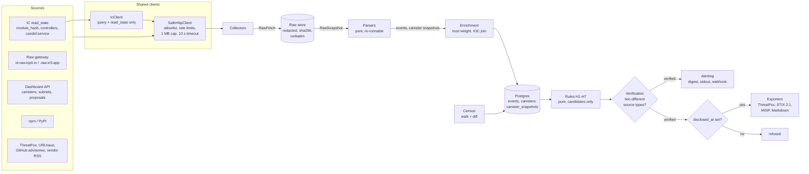

# Architecture

`icp-threat-intel` collects public signals about Internet Computer (ICP) canisters,
stores every response verbatim, turns them into normalized events, scores the events
with one rule per hypothesis (SPEC §4), verifies detections with a two-signal rule and
exports IOCs. `PLAN.md` has the full design and data model; this page is the overview.

## Pipeline

| Stage | Package | Notes |
|---|---|---|
| Collect | `collectors/` | `read_state.py`, `raw_gateway.py`, `dashboard.py`, `signals_feed.py`, `signals_search.py` (community forums), `signals_hn.py` (Hacker News) and `signals_blocklist.py` (community phishing blocklists), all low authority; every response, errors included, becomes a `RawFetch`. |
| Store | `raw_store/` | Redaction (guardrail 5) before insert; idempotent on (source, url, sha256). Parsers re-run over history. |
| Parse | `parsers/` | One parser per source; deterministic dedup keys; `parsers/ingest.py` persists events and canister snapshots. |
| Enrich | `enrichment/` | Source reliability (0-100, `core/trust.py`) applied at ingest; IOC membership from the `iocs` table. LLM and Wasm hooks are documented, not implemented. |
| Census | `census/` | Walks subnets through the Dashboard API, records each canister, diffs against the previous run. Partial walks never report removals. |
| Score | `rules/` | H1 dead-drop C2, H2 lifecycle, H3 supply chain, H7 exfiltration store (extension); H4-H6 registered stubs. One detection per rule and subject; new evidence is merged. |
| Verify | `verification/` | `candidate → verified` only with evidence from ≥2 source types (signal sources such as forums do not count); audited dismissal. |
| Alert | `alerting/` | Daily digest (Markdown + JSON), immediate alerts for verified detections. |
| Publish | `publishing/` | Disclosure gate first; ThreatFox file is for human review, never sent. |

Safety lives in code, not in documentation: see the guardrail list in `CLAUDE.md` and the
tests in `tests/guardrails/`.

## What the IC does not let us see

Canister **module bytes cannot be downloaded** from the network (SPEC §3). We cannot read
a canister's Wasm, decompile it or diff two versions. What *is* observable:

- the **module hash** (SHA-256 of the installed Wasm) and the **controllers**, through a
  certified `read_state` call;
- the **Candid interface**, when the canister publishes `candid:service` as a public
  metadata section (it may be private or absent);
- what the canister **serves over HTTP** through the raw gateway (uncertified, and fully
  under the canister's control);
- **index data**: subnet, canister type and counts from the Dashboard API, and NNS
  proposals;
- **outside references**: registry packages, IOC feeds, advisories and vendor write-ups.

Each rule is built from those observables only:

| Rule | How it works around the missing module bytes |
|---|---|
| **H1 dead-drop C2** | Reads *behaviour from the interface*: an update setter paired with a getter (`update_link`/`get_link`, the CanisterWorm shape), plus the gateway body actually served (a small URL, base64 blob or shell fragment). Two independent observables replace code inspection. If Candid is private, H1 cannot fire; the gateway body alone is never enough. |
| **H2 lifecycle** | Uses the **module hash as a fingerprint**: any change means new code was installed, even though we cannot see what changed. Controller changes and stopped→running flips come from `read_state`, the Dashboard API and census diffs. Hours since the last takedown or proposal give context. |
| **H3 supply chain** | Looks **outside the IC**: package install hooks, `.pth` lines and decoded strings that reference a canister ID, an IC gateway host or host indicators (`/tmp/pglog`, `pgmon.service`). The malicious code is in the package, which we can read, not in the canister. |
| **H4 cycles funding** (stub) | Follows **money, not code**: ICP ledger transfers to the Cycles Minting Canister with the IOC canister's top-up subaccount (`TPUP` memo). Funding accounts link canisters whose code we cannot compare. |
| **H5 governance** (stub) | Uses **public governance records**: NNS proposals naming IOC canisters or subnets, and gateway `451 denylisted` answers, to measure time-to-action. |
| **H7 exfiltration store** (extension beyond SPEC) | Reads *behaviour from the interface* like H1: an update method that writes a blob/text payload plus query read-backs (`store`/`list`/`get`), confirmed by the canister answering HTTP. The CanisterSprawl shape. |
| **H6 mass creation** (stub, unverified hypothesis) | Uses **hash equality and absence**: many canisters created in a burst on one subnet or controller, with no public Candid and identical or tiny module hashes. Identical hashes prove identical code without reading it. |

Two further consequences:

- **The raw gateway is uncertified.** A canister decides what it serves and can serve
  different content to different clients, so gateway bodies are weighted lower
  (`core/trust.py`) and never verify a detection alone.
- **Certificates are not yet BLS-verified** (`unverified:no_bls`). `read_state` events say
  so in their payload, and the two-signal rule still requires a second source type.

Static analysis of Wasm is left as an extension point (`enrichment/extension_points.py`)
for modules obtained legitimately from public source repositories and matched to on-chain
module hashes, never fetched from the IC.
